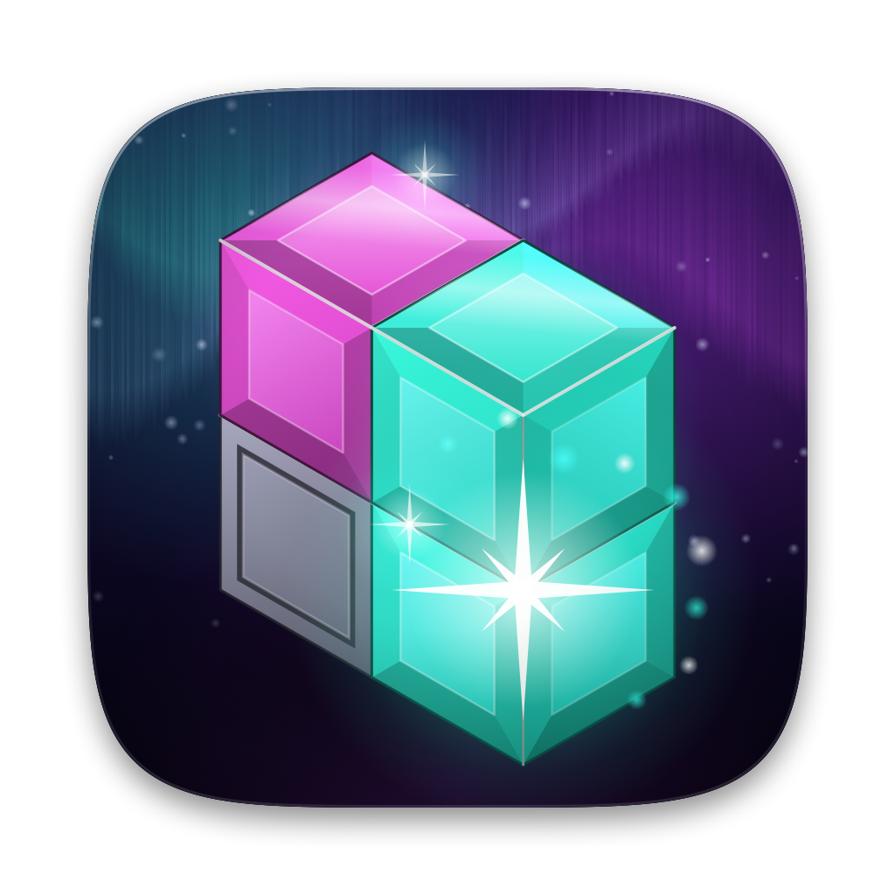

<p align="center">
  
</p>

<h1 align="center">Puzznic Remastered</h1>

<p align="center">
  A native macOS app (Swift · Metal) that runs the original NES game code unchanged,<br>
  with a modern 2026 renderer and remastered sound.
</p>

> **Bring your own ROM.** No game data is included in this repository. You need your own dump
> of *Puzznic* for the NES (`.nes`, iNES format). This project is not affiliated with or endorsed by Taito or Nintendo.

## Features

* **Original gameplay**: the game's own 6502 code runs on a cycle-counted NES core, so the
  block physics, timers and every puzzle are untouched.
* **Remastered 2026 graphics**: resolution-independent pixel-art reconstruction, glossy surface
  lighting, soft shadows, an animated aurora backdrop behind the playfield, bloom, filmic tonemapping and lens effects.
* **Classic and CRT modes**: crisp pixels, or a CRT look with scanlines, aperture grille and curvature.
* **Remastered 2026 sound and music**: the original score performed live by a modern stereo synth
  with chorus and reverb. You can switch back to the authentic NES sound at any time.
* **Configurable**: graphics, audio and input settings (keyboard and gamepad for 2 players), presets,
  turbo buttons, save states and fast-forward.
* **Native**: SwiftUI + MetalKit + AVAudioEngine + GameController, with no third-party dependencies.

## Getting started

**Requirements:** macOS 13 Ventura or newer, and Xcode 15+ or the Command Line Tools (Swift 5.9+).

```bash
# put the repo next to your ROM, e.g.
#   Puzznic/
#   ├── Puzznic.nes
#   └── PuzznicRemastered/      ← this project
git clone https://github.com/lydianb79/Puzznic.git PuzznicRemastered
cd PuzznicRemastered
./build_app.sh
open "build/Puzznic Remastered.app"
```

* If `../Puzznic.nes` exists, `build_app.sh` copies it into the app bundle.
* Otherwise, use **File › Open ROM… (⌘O)** or drag the `.nes` file onto the window. The app
  remembers the last ROM you opened.
* `UNIVERSAL=1 ./build_app.sh` builds a universal binary (Apple silicon + Intel).
* `swift run` works for quick iteration. The app then runs without a bundle, so there is no Dock icon.

## Settings (⌘,)

### Graphics
| Option | |
|---|---|
| Render mode | **Remastered (2026)**, **Classic Pixels** or **CRT** |
| Presets | Remastered Ultra, Remastered Light, Classic, CRT (also in **Game › Graphics Preset**) |
| Remastered | Reconstruction quality (up to 8× internal), edge rounding and sharpness, surface lighting, specular, rim light, shadows, light direction, background (Original / Aurora / Gradient), light motes |
| CRT | Scanlines, aperture grille, curvature |
| Post-processing | Bloom (intensity, threshold), ACES tonemapping, exposure, saturation, contrast, vignette, chromatic aberration, film grain |
| Display | 4:3 NTSC or square pixels, integer scaling, overscan crop, ambient-glow or black borders, render scale, V-Sync, FPS counter, remove sprite flicker |
| NES palette | Saturation and hue shift |

**How the remastered renderer works:** the PPU exports separate colour layers (background,
sprites with priority, backdrop per scanline) rather than only a finished bitmap. Metal compute
shaders rebuild each layer at high resolution: a Gaussian coverage field with anti-aliased
thresholding turns stair-steps into clean diagonals and curves, and a B-spline height field supplies
the lighting normals. The scene pass composites the layers with shadows over a procedural
aurora sky with rising light motes (it shows wherever the game draws its backdrop colour:
the playfield interior, the HUD and the title screen). A 6-level bloom chain and a filmic composite finish the image.

### Audio
| Option | |
|---|---|
| Sound & music | **Original (NES 2A03)** or **Remastered 2026** |
| Remastered | Lead instruments (Clean / Warm Analog / Supersaw), reverb, stereo width, bass |
| Output | Volume, mute, mute when in background |
| Channels | Pulse 1, Pulse 2, Triangle, Noise and DPCM can each be switched on or off |

**How the remastered sound works:** the original music driver still runs. A synth reads the
sound chip's registers every sample and plays the same notes with band-limited (PolyBLEP)
oscillators and resonant filters. Leads are spread in stereo with chorus, the triangle becomes a warm
bass with a sub-octave, and noise becomes filtered drums. A Freeverb-style hall reverb and a soft
limiter finish the mix, which is level-matched to the original.

### Controls
Every binding can be changed. Click a slot, then press a key or controller button (Esc cancels).
Xbox, PlayStation, Switch Pro and MFi controllers are supported, and you can set the stick dead
zone and turbo rate.

| NES | Player 1 | Player 2 | Gamepad |
|---|---|---|---|
| D-Pad | Arrow keys | I J K L | D-Pad / left stick |
| A | X | H | East (B / ○) |
| B | Z | G | South (A / ✕) |
| Turbo A / B | S / A | – | North / West |
| Start | Return | Y | Menu |
| Select | Right Shift | T | Options |

| Shortcut | Key | Menu |
|---|---|---|
| Pause / resume | P | ⌘P |
| Fast-forward (hold) | Tab | |
| Quick save / load | F5 / F7 | ⌘S / ⌘L |
| Reset | F2 | ⌘R |
| Open ROM | | ⌘O |

## Project structure

```
Package.swift                     Swift package (macOS 13+)
build_app.sh                      builds and assembles "Puzznic Remastered.app"
Sources/NESCore/                  C core: 6502 CPU, PPU + layer export, APU + remastered synth,
                                  NROM / UxROM / CNROM mappers, controllers, save states
Sources/PuzznicRemastered/
  App.swift                       app, menus
  GameView.swift                  MTKView host, overlays, drag & drop
  Renderer.swift                  Metal pipeline
  Shaders.swift                   Metal shaders (compiled at launch)
  GameSession.swift               frame pacing, audio rate control, save states, hotkeys
  Emulator.swift / Audio.swift    core wrapper / AVAudioEngine stereo output
  Input.swift                     keyboard + game controllers, rebinding
  Settings.swift / SettingsView.swift
Resources/                        Info.plist, AppIcon.png, IconAlternates/
Tools/headless.c                  command-line test runner for the core
Tools/make_icon.swift             procedural CoreGraphics renderer for the app icon
```

## App icon

The icon is original artwork (glossy isometric gem cubes on an aurora sky, two matching cubes
bursting into a sparkle) rendered by `swift Tools/make_icon.swift Resources/AppIcon.png aurora`.
`build_app.sh` converts it to `AppIcon.icns`. An orange "Ember" variant
(`... ember`) is in `Resources/IconAlternates/`. To switch, copy it over `Resources/AppIcon.png` and rebuild.

## Troubleshooting

* **Icon doesn't show after a rebuild**: macOS caches icons per path. The build script
  re-registers the app, but if Finder still shows a blank icon, run `killall Dock Finder`.
* **"Unsupported mapper"**: NROM, UxROM and CNROM (mappers 0, 2, 3) are supported. Puzznic is CNROM.
* **No sound**: check Settings › Audio (mute, *mute when in background*, channel switches).
* **Opening the app on another Mac**: the bundle is only ad-hoc signed. If macOS blocks it,
  right-click the app and choose **Open**, or run `xattr -dr com.apple.quarantine "Puzznic Remastered.app"`.
* **Black window or crash at launch**: run the binary from Terminal to see the log:
  `"build/Puzznic Remastered.app/Contents/MacOS/PuzznicRemastered"`. Metal shader compile
  errors are printed there.

## Development

Test the core headlessly. This runs N frames with scripted input and writes PPM frames and layer
dumps to `out/` every K frames:

```bash
cc -O2 -ISources/NESCore/include Sources/NESCore/nescore.c Tools/headless.c -o headless -lm
mkdir -p out && ./headless "../Puzznic.nes" 1200 "start@300-306,start@500-506,start@700-706" 300
```

Save states are stored in `~/Library/Application Support/Puzznic Remastered/States/`.
Settings are stored in the app's `UserDefaults`.
